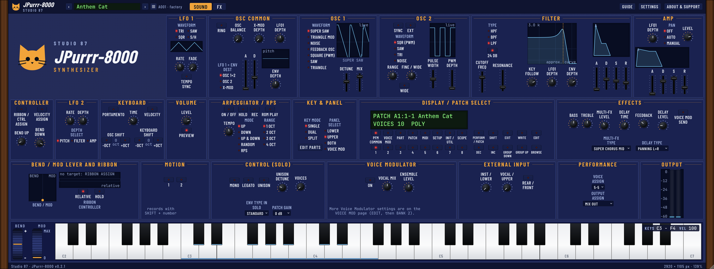

# JPurrr-8000

Nice twist on a trance classic, a nod to the famous JP-8000.

A free and open source VST3 synth and standalone app for Linux, Windows and macOS, in the spirit of the late 90s JP-8000 and JP-8080.



## Status

Version 0.2.1 (test release). The synth engine, the FX chain, the MASTER section, factory sounds (51), the MIDI map and JP-8000/JP-8080 SysEx patch import and export are in. New in 0.2.0: your own FX block presets, a playable keyboard strip with BEND and MOD wheels, and DUAL and SPLIT with a different sound in each part (EDIT PARTS). The window is built from the approved design mockup ([docs/mockups/JPurrr-8000-mockup-v3.6.html](docs/mockups/JPurrr-8000-mockup-v3.6.html)). Not done yet: voice modulator, external input, RPS recording, Motion. See [ROADMAP.md](ROADMAP.md) for the full list.

## The idea

- **Sound page:** the JP-8000 front panel experience: Super Saw and the other oscillators, filter, LFOs, amp, arpeggiator, effects, key modes, patch select display.
- **FX page:** our own twist. A mix ready chain (trance gate, drive stack, low end, M/S EQ, transient, tamer, glue, widener, auto pan) and a MASTER page (opto leveller, OTT style squeeze, a four band multiband compressor and limiter, clipper and limiter), so every sound comes out sounding finished. Every block has its own preset menu.
- Live displays that react to the sound going through.
- **Block presets:** every FX block has a preset menu with factory settings. SAVE keeps the knobs of a block as your own preset (it then shows under YOUR PRESETS); the ... button renames or deletes it.
- **Keyboard strip:** a piano at the bottom of the window with BEND and MOD wheels. Play it with the mouse or the computer keys, laid out like Ableton Live (`A S D F G H J K L ; '` are the white keys, `W E T Y U O P` the black keys, `Z` and `X` move the octave, `C` and `V` set the velocity). BEND springs back, MOD stays where you leave it. The PREVIEW switch hides it. The strip plays the sound itself and sends no MIDI out.
- **EDIT PARTS:** in DUAL and SPLIT the UPPER and LOWER parts each keep their own sound. EDIT PARTS opens a band with the two sounds and a keys map; in SPLIT the split point is a marker on the keyboard strip that you drag. The window height follows the page: the SOUND, CHAIN and MASTER pages have different heights, the strip and the PARTS band add to them.
- Presets: load and save our own `.json` format, and import JP-8080 SysEx patches and banks (`.syx`); an Export dialog that asks for the format (JSON text, JP-8080 or JP-8000 SysEx), one sound or the whole bank, the device ID (17 to 32) and the destination (edit buffer or a user slot A11 to B88). MIDI CC and NRPN control is documented in [docs/midi-and-sysex.md](docs/midi-and-sysex.md).

Works 100% offline.

## Install

Download the files from the [latest release](https://github.com/SpeakingColors/JPurrr-8000/releases/latest). Close your DAW first and rescan plugins afterwards. Presets and settings are never removed by an uninstall. Every release has a `SHA256SUMS.txt` to check your download.

**Linux (x86_64):** unpack `JPurrr-8000-<version>-Linux-x86_64.tar.gz` and run `./install.sh`. It installs for your user only, no root needed: the plugin to `~/.vst3`, the standalone app to `~/.local/bin`, plus a menu entry. `./install.sh --dry-run` shows what it would do, `./install.sh --uninstall` removes it again, `sudo ./install.sh --system` installs for all users (not on immutable systems such as Bazzite).

**Windows 10 and 11 (64 bit):** run `JPurrr-8000-<version>-Windows-x64-Setup.exe`. The plugin goes to `C:\Program Files\Common Files\VST3`, the standalone app to `C:\Program Files\Studio 87\JPurrr-8000`. The setup is not signed, so SmartScreen may show "Windows protected your PC": click More info, then Run anyway. Uninstall in Settings, Apps.

**macOS (Apple silicon and Intel):** open `JPurrr-8000-<version>-macOS.pkg`. It is not signed or notarized by Apple (their program costs 99 US dollars a year; this project is free), so macOS warns the first time. Easiest: download it in Terminal, which adds no warning mark: `curl -L -o ~/Downloads/JPurrr-8000.pkg <release download URL of the .pkg>` then `open ~/Downloads/JPurrr-8000.pkg` (tested on a Mac: no warning). Other ways, and why, are in [docs/macos-install.md](docs/macos-install.md). The plugin goes to `/Library/Audio/Plug-Ins/VST3`, the app to `/Applications`. The uninstaller is `uninstall.command` in `/Library/Application Support/Studio 87/JPurrr-8000`.

**Just copy the plugin:** the VST3 is a folder. Copy `JPurrr-8000.vst3` to `~/.vst3/` (Linux), `C:\Program Files\Common Files\VST3\` (Windows) or `/Library/Audio/Plug-Ins/VST3/` (macOS; run `xattr -dr com.apple.quarantine JPurrr-8000.vst3` on it first).

## Manual

The user manual is [docs/manual/JPurrr-8000-manual.pdf](https://github.com/SpeakingColors/JPurrr-8000/blob/main/docs/manual/JPurrr-8000-manual.pdf) (source: [docs/manual/manual.md](docs/manual/manual.md)). Rebuild it with `python3 scripts/build_manual.py` (needs the Python packages `markdown`, `playwright` and `pypdf`, and `playwright install chromium`). The screenshots in `docs/manual/img/` are taken from the real plugin editor with the `jpurrr_snapshot` tool.

## App icon

The icon (orange cat on indigo) lives in [assets/icon](assets/icon). `python3 tools/make_icons.py` makes every file the installers use (Windows .ico, macOS .icns, Linux PNG sizes and SVG). The steps for other apps are in [docs/app-icons-checklist.md](docs/app-icons-checklist.md).

## Build from source

Needs CMake 3.22 or newer and a C++17 compiler. The plugin build fetches JUCE by itself (pinned in `plugin/CMakeLists.txt`).

```sh
# core tests with sanitizers (Linux, macOS)
sh tests/run.sh

# plugin: VST3 and standalone
cmake -S . -B build -DCMAKE_BUILD_TYPE=Release -DJPURRR_BUILD_PLUGIN=ON -DJPURRR_BUILD_TESTS=OFF
cmake --build build --parallel 2
# result: build/plugin/JPurrr8000_artefacts/Release/{VST3,Standalone}
```

On Linux install these packages first (Debian and Ubuntu names): `libasound2-dev libx11-dev libxrandr-dev libxinerama-dev libxcursor-dev libfreetype-dev libfontconfig1-dev libgl1-mesa-dev libxext-dev`. On Windows use `-A x64` and `--config Release`. For a universal macOS build add `-DCMAKE_OSX_ARCHITECTURES="arm64;x86_64"`.

Releases are built by GitHub Actions: pushing a tag like `v0.2.0` (it must match the version in `CMakeLists.txt`) builds all three systems, makes the installers and publishes the release. `scripts/` and `installer/` hold the packaging.

## Licence

AGPL-3.0-or-later. See [LICENSE](LICENSE).

Not affiliated with or endorsed by Roland or Arturia. All names belong to their owners.

## Support

Free to use. If you like it, you can leave a tip on [Ko-fi](https://ko-fi.com/studio87).
