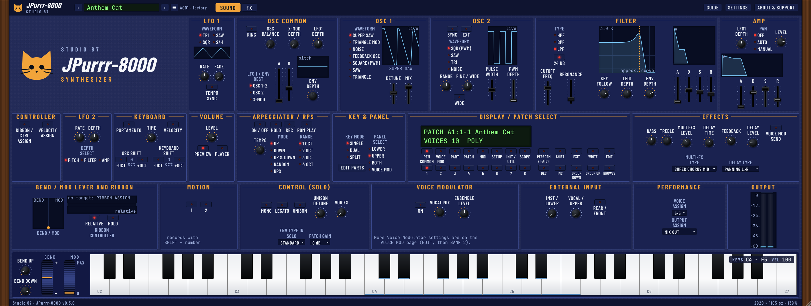
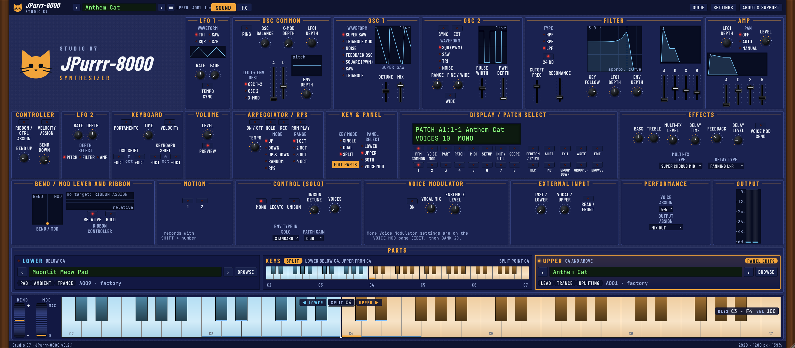
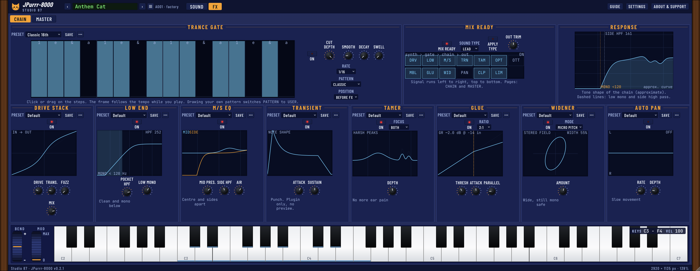
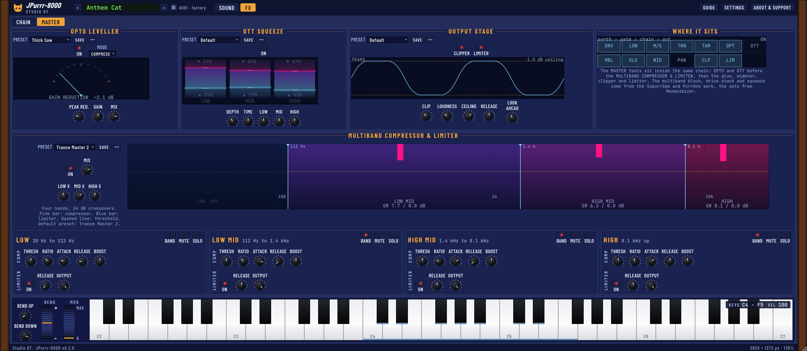
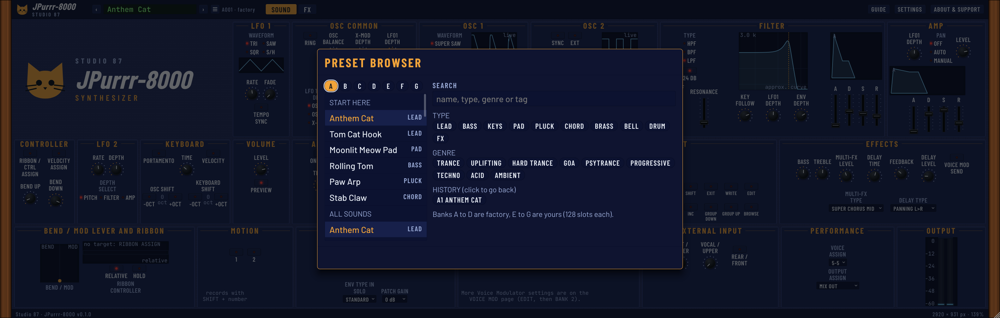
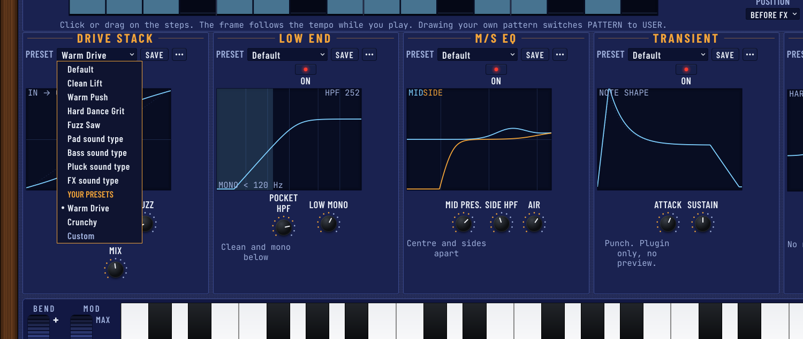
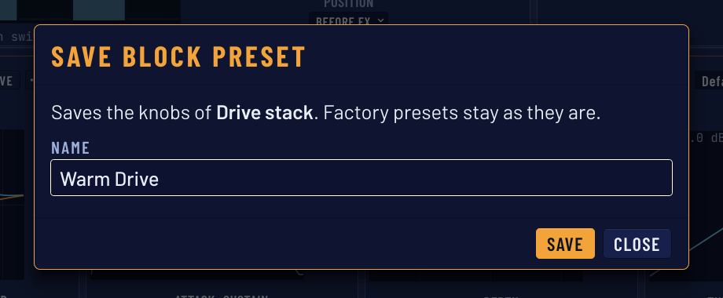
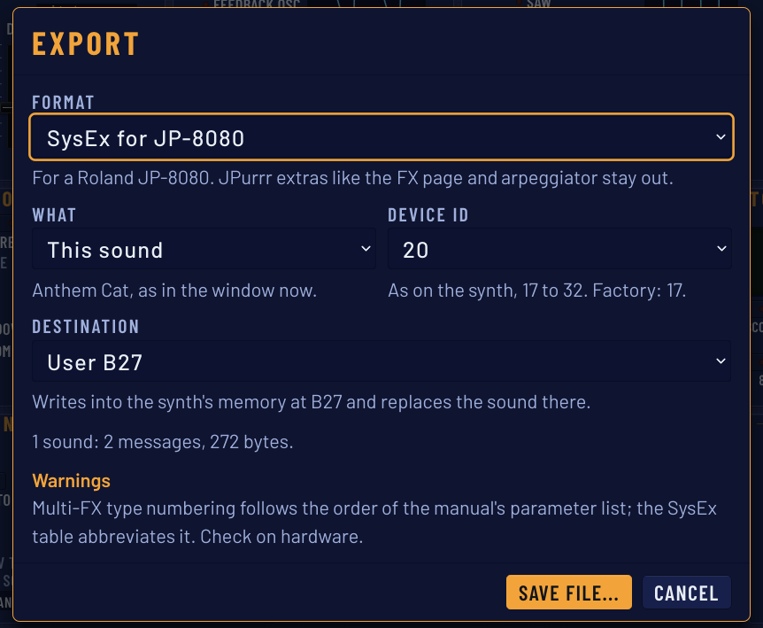

<!--
Source of the JPurrr-8000 user manual. Build the PDF with: python3 scripts/build_manual.py
Image slots: . The script uses docs/manual/img/<name>.png when it exists
and falls back to the design mockup (docs/screenshot.png) when it does not.
Items marked (planned) are not in the plugin yet. Before a release, check each (planned) and each
line in "Known limits" against the real build and remove or keep the mark.
The screenshots in img/ are taken from the real editor with the jpurrr_snapshot tool.
-->

# What JPurrr-8000 is

JPurrr-8000 is a free and open source synthesizer plugin (VST3) and standalone app for Linux, Windows and macOS. It follows the sound and the front panel of the late 90s JP-8000 and JP-8080: Super Saw oscillator, filter, LFOs, amp, arpeggiator, effects and the patch select display. On top of that it has its own FX page, a mix ready processing chain, so a sound comes out ready for a track.

- Works 100% offline. No account, no update check, nothing is locked.
- Stereo output, MIDI input. Use it as an instrument in your DAW. The piano strip at the bottom of the window plays it without a MIDI keyboard.
- Free software under AGPL-3.0-or-later.

JPurrr-8000 is not a copy of a Roland product. It contains no Roland code, ROM or samples. It is not affiliated with or endorsed by Roland or Arturia. All names belong to their owners.

# Install

Close your DAW before you install, then rescan plugins afterwards. Presets and settings are kept when you uninstall.

## Linux

1. Download `JPurrr-8000-<version>-Linux-x86_64.tar.gz` from the releases page and unpack it.
2. Open a terminal in the unpacked folder and run `./install.sh`.

This installs for your user only, without root: the plugin goes to `~/.vst3`, the standalone app to `~/.local/bin`, and a menu entry is added. Run `./install.sh --dry-run` first to see what it would do. `./install.sh --uninstall` removes it again. `sudo ./install.sh --system` installs for all users (not possible on immutable systems such as Bazzite, where the user install is the right choice).

Just copy it yourself: put the folder `JPurrr-8000.vst3` into `~/.vst3/`.

## Windows

1. Download `JPurrr-8000-<version>-Windows-x64-Setup.exe` and run it.
2. If SmartScreen says "Windows protected your PC", click More info, then Run anyway. The setup is not signed, because a signing certificate costs money and this project is free. You can compare the file with `SHA256SUMS.txt` from the releases page.

The plugin goes to `C:\Program Files\Common Files\VST3`, the standalone app and this manual to `C:\Program Files\Studio 87\JPurrr-8000`. Uninstall in Settings, Apps. Installing a newer version over the old one works; close your DAW first because it locks the plugin file.

Just copy it yourself: put the folder `JPurrr-8000.vst3` into `C:\Program Files\Common Files\VST3`.

## macOS

1. Download `JPurrr-8000-<version>-macOS.pkg` (Apple silicon and Intel in one file) and open it.
2. The package is not signed or notarized by Apple, so macOS warns you the first time ("Apple could not verify ... is free of malware"). This does not mean it is infected. It means Apple has not checked it: Apple only skips the warning for developers who pay 99 US dollars a year, and JPurrr-8000 is free software. You can check the download yourself with `SHA256SUMS.txt` (`shasum -a 256 -c SHA256SUMS.txt`), and the source code is public.
3. Easiest way: download the package in Terminal instead of the browser. The browser marks the file "from the internet" and that mark triggers the block; `curl` does not add it. Run `curl -L -o ~/Downloads/JPurrr-8000.pkg <the download link of the .pkg on the release page>` and then `open ~/Downloads/JPurrr-8000.pkg`. The installer opens with no warning.
4. If you already downloaded it with the browser: double click the package, close the message, open System Settings, Privacy & Security, scroll to Security and click Open Anyway (the button stays for about an hour), then confirm with your password. If the same message comes back, run `xattr -d com.apple.quarantine ~/Downloads/<the .pkg file name>` in Terminal and open it again. On macOS 14 and older: right click the file, choose Open, then Open again. Only do this for files from the official release page.

The plugin goes to `/Library/Audio/Plug-Ins/VST3`, the app to `/Applications`, and the manual and `uninstall.command` to `/Library/Application Support/Studio 87/JPurrr-8000`. If you copy the plugin by hand, run `xattr -dr com.apple.quarantine JPurrr-8000.vst3` on it first.

# First sound

1. Add JPurrr-8000 as an instrument on a MIDI track in your DAW (or start the standalone app and choose your audio and MIDI device in its options).
2. Play a note.
3. Click the preset name at the top to open the preset browser. The START HERE list has a few good first sounds. The arrows next to the name step through presets.
4. Turn the knobs. Hover a control for one second to see what it does.
5. No MIDI keyboard? Play the piano at the bottom of the window with the mouse, or with the computer keys (see The piano strip).
6. Open the FX tab. MIX READY is on by default, so the sound already runs through the chain. Pick a SOUND TYPE (LEAD, PAD, BASS, PLUCK, CHORD or FX) and press APPLY TYPE to set every module for that kind of sound.

# The window

The top bar has the preset name with the arrows and the preset menu, the SOUND and FX tabs, and the buttons Guide, Settings and About & Support. The wooden side cheeks frame the panel.

- **Knobs and sliders:** drag up and down. Hold Shift for fine steps. The mouse wheel and the arrow keys work too. Double click (or press Enter) to reset to the default.
- **Bubbles:** hover a control for about one second to see its help bubble. Turn them off in Settings.
- **Size:** drag any edge or corner. The shape stays the same and everything scales. Double click a wooden cheek to return to 100%. The window keeps its width when you change page, and the height follows the page (see Window sizes below).
- **Value display:** while you turn a control, its name and value show in the patch display.

## Window sizes

Every page has its own height at the same width, so nothing is cut off and nothing is empty. The numbers are at 100% size (2920 px wide):

| Page | Without the piano | With the piano (PREVIEW on) |
|---|---|---|
| SOUND | 931 px | 1105 px |
| FX, CHAIN | 961 px | 1135 px |
| FX, MASTER | 1099 px | 1273 px |

EDIT PARTS (SOUND page only) adds the PARTS band, 175 px more. When you drag the window bigger or smaller, the shape of the current page stays the same.

## The piano strip

The piano at the bottom of the window (see the picture at the start of this manual) plays the sound itself, so you can try a sound without a MIDI keyboard. It plays through the same key mode, arpeggiator and effects as a MIDI note. It sends no MIDI out: your DAW does not record it.

- **Mouse:** press a key to play it, drag across the keys to glide (glissando). Where a black key overlaps a white one, the black key wins.
- **Computer keys:** the lower row plays from C3: `Z S X D C V G B H N J M` are C, C#, D, D#, E, F, F#, G, G#, A, A# and B, and `,` is the C above. The upper row plays from C4: `Q 2 W 3 E R 5 T 6 Y 7 U` and `I` is the C above. Typing in a text field never plays a note, and keys with Ctrl or Cmd are left to the DAW.
- **BEND wheel (left):** drag up or down, or use the arrow keys while it has focus. It springs back to the middle when you let go. The range is BEND UP and BEND DOWN.
- **MOD wheel:** moves the mod lever (what the CC 1 message moves too, so LFO 2 depth). It stays where you leave it. Double click or Home resets it to 0. The wheels write the same lever values as the BEND / MOD lever display in the lower left of the SOUND page, so both always agree.
- **PREVIEW** (in the VOLUME box) hides or shows the strip. Hiding it lets go of any held key and makes the window shorter.

# The Sound page

The Sound page is the front panel. Values are whole numbers as on the original; many controls show their real unit (cent, Hz, ms) while you turn them.

## Display and patch select

The two line display shows the current sound. BANK buttons 1 to 8 and NUMBER buttons 1 to 8 pick a sound in the current group. GROUP DOWN and GROUP UP change the group (64 sounds each), DEC and INC step one sound. PERFORM / PATCH switches the display view. WRITE opens Save. EDIT then a BANK button opens a parameter page (see "Parameter pages"). EXIT closes it. SHIFT is the second function key.

## Oscillators

| Control | What it does |
|---|---|
| OSC 1 WAVEFORM | SUPER SAW (the 7 saw stack), TRIANGLE MOD, NOISE, FEEDBACK OSC, SQUARE (PWM), SAW, TRIANGLE. |
| OSC 1 CTRL 1, CTRL 2 | Depend on the waveform. For SUPER SAW: CTRL 1 spreads the six outer saws away from the centre, CTRL 2 sets how loud they are against the centre saw. |
| OSC 2 WAVEFORM | SQR (PWM), SAW, TRI, NOISE. RANGE sets the pitch against OSC 1 (-24 to +24 semitones), FINE tunes in cent. WIDE moves RANGE and FINE in whole octaves. PULSE WIDTH and PWM DEPTH are for SQR. |
| SYNC | Hard sync: OSC 2 restarts with OSC 1. |
| EXT | Use the external input as the OSC 2 source (see Known limits). |
| RING | Ring modulator: OSC 1 times OSC 2, for metallic and bell sounds. |
| OSC BALANCE | Mix between OSC 1 (left) and OSC 2 (right). |
| X-MOD DEPTH | OSC 2 modulates the pitch of OSC 1. Not with SUPER SAW or NOISE. |
| LFO1 DEPTH, LFO 1 + ENV DEST | How much LFO 1 moves the oscillators, and where: both, OSC 2 only, or the cross modulation depth. |
| PITCH ENV A, D, ENV DEPTH | Pitch envelope. A negative depth starts high and falls. |
| OSC SHIFT, KEYBOARD SHIFT | Move the oscillators or the keyboard by whole octaves with the -OCT and +OCT buttons. |

FEEDBACK OSC is mono only: it forces MONO or LEGATO and cannot be used with UNISON.

## Filter

TYPE: HPF, BPF or LPF. The 24 dB button switches between 12 and 24 dB per octave. CUTOFF FREQ, RESONANCE (at the top the filter rings and gives a sine tone) and KEY FOLLOW (+32 keeps the brightness equal over the keyboard). LFO1 DEPTH and ENV DEPTH move the cutoff; a negative ENV DEPTH inverts the envelope. The filter envelope has A, D, S and R.

## Amp

LEVEL of the patch, the amp envelope (A, D, S, R), and LFO1 DEPTH for tremolo. PAN: OFF is centre, AUTO sweeps with LFO 1, MANUAL uses the LFO1 DEPTH knob as the position.

## LFO 1 and LFO 2

LFO 1: WAVEFORM (TRI, SAW, SQR, S/H), RATE, FADE (time to reach full depth after a key press) and TEMPO SYNC to the host tempo. LFO 2 is moved by the mod lever: RATE, DEPTH, and DEPTH SELECT to send it to PITCH (vibrato), FILTER or AMP.

## Keyboard, controller and ribbon

- **PORTAMENTO** with TIME: pitch glides from note to note. **VELOCITY** switch: how hard you play changes the morph destinations.
- **MONO** and **LEGATO** (one note at a time; legato joins notes smoothly), **UNISON** with UNISON DETUNE (0 to 50 cent), **VOICES** (maximum number of voices, 8 up to 128; more voices use more CPU), **ENV TYPE IN SOLO** (ANALOG lets a new note continue from where the old envelope was), **PATCH GAIN** (0, +6 or +12 dB).
- **RIBBON / CTRL ASSIGN:** press it, then move a knob or slider. The ribbon and the control lever now move that parameter. **VELOCITY ASSIGN** does the same for velocity (morphing). BEND UP and BEND DOWN set the pitch bend range. On the ribbon, RELATIVE changes the value around where it is, and HOLD keeps it when you let go.

## Arpeggiator and RPS

ON / OFF, HOLD (keep playing after you let go), MODE (UP, DOWN, UP & DOWN, RANDOM, RPS), RANGE (1 to 4 octaves) and TEMPO. Hold a chord (on a MIDI keyboard or on the piano strip) and the arpeggiator plays its notes one after the other, a step every 1/16 note by default. In a DAW the speed follows the host tempo, and the TEMPO knob is not used. The standalone app has no host tempo, so there the TEMPO knob (20 to 250 BPM) sets the speed of the arpeggiator and of the tempo synced effects. A new chord always starts at the beginning of the pattern. The beat pattern list (on the parameter pages) has 90 entries from 1/4 to 1/32 and the PORTA, SEQUENCE, ECHO, MUTE, STRUMMING, REFRAIN, PERCUSSION, WALKING BASS, HARP and RANDOM groups. REC and ROM PLAY are for the RPS (see Known limits). The two MOTION buttons are on the panel but do nothing yet (planned).

## Key mode and panel select

KEY MODE: SINGLE, DUAL (two sounds layered) or SPLIT (a split point, one sound per side). In DUAL and SPLIT the sound has two parts, UPPER and LOWER, and each part keeps its own sound. PANEL SELECT chooses which part the panel edits: LOWER, UPPER, BOTH (edits the two parts together) or VOICE MOD. The knobs always show the part you are editing; both sounds are saved with your DAW project. VOICE ASSIGN shares the voices between the two parts (8-2 down to 2-8). OUTPUT ASSIGN mixes both parts, or sends lower left and upper right.

## EDIT PARTS

The EDIT PARTS button on the SOUND page opens the PARTS band between the panel and the piano strip: the UPPER and LOWER cards at the sides and a map of the keys between them. Press it again to close the band and get the window height back.

- **The cards** show the sound of each part with its name and genre tags. The arrows step through the presets for that part and BROWSE opens the preset browser for it; what you pick goes to that part only. A click on a card puts that part's sound on the panel for editing (this is PANEL SELECT). In KEY MODE SINGLE the LOWER card is greyed out: there is only one part.
- **The keys map and the split point:** in SPLIT the keys below the split point play LOWER and the keys from the split point up play UPPER. The piano strip shows the split as a marker; drag it, or focus it and use the arrow keys (one key) or Page Up and Page Down or Shift with the arrows (one octave). The split point stops at C7. In DUAL both parts play every key, and the keys carry both tints. Without the band the strip is plain.
- **Loading a sound** from the browser goes to the part you are editing. The effects section (bass, treble, multi-FX and delay) is one effect for both parts and follows the UPPER sound; the voices, the arpeggiator, the MIX READY chain and the setup follow the panel and are shared.
- **Old sessions** made with version 0.1.0 load as before: both parts get the one saved sound.

## Effects

The built in effects of the Sound page: BASS and TREBLE tone shelves, the MULTI-FX (twelve chorus, flanger and phaser types plus DISTORTION) with its LEVEL, and the DELAY with TIME, FEEDBACK, LEVEL and five types (panning left to right, right to left, short panning, mono short, mono long). TEMPO SYNC choices for chorus and delay are on the parameter pages.

## Parameter pages

Press EDIT, then a BANK button: PFM COMMON, VOICE MOD, PART, PATCH, MIDI, SETUP, INIT / UTIL or SCOPE. These hold the less often used settings, such as the split point, part transpose and detune, MIDI channels, tempo sync choices, master tune and LCD contrast. EXIT closes the page.

# The FX page

The FX tab is our own twist: a processing chain that makes a sound ready for a mix. It has two pages, CHAIN and MASTER. Every module has an ON switch, and every block has its own preset menu. The MIX READY master switch turns the whole chain on or off; switch it off to hear the raw synth. The displays show the sound as it moves through the chain.

## MIX READY and the trance gate

- **MIX READY:** the master switch, SOUND TYPE (LEAD, PAD, BASS, PLUCK, CHORD, FX), APPLY TYPE (sets every module for that type) and OUT TRIM (-12 to +12 dB after the limiter).
- **TRANCE GATE:** a 16 step gate that chops the sound in time with the host tempo. Click or drag on the steps to draw a pattern (PATTERN then reads USER) or choose a built in pattern. CUT DEPTH is how low the sound falls between steps (0 dB to -60 dB, top is silent). SMOOTH softens the edges. DECAY lets each open step fall away like a pluck. SWELL lets the gap rise back into the next note. RATE is the step length (1/4 to 1/32, triplets included). POSITION: BEFORE FX lets delay tails ring between steps, AFTER FX chops the effects too.
- **RESPONSE:** a display of the tone shape of the whole chain.

## CHAIN page

| Module | What it does |
|---|---|
| DRIVE STACK | Three stages in a row: DRIVE (smooth opamp saturation), TRANS. (asymmetric transistor stage, adds even harmonics) and FUZZ (gritty, with an octave up growl). MIX blends clean and driven. |
| LOW END | POCKET HPF clears the low mids so kick and bass keep their pocket (pads and leads about 250 to 300 Hz, bass off). LOW MONO makes everything below its frequency mono (about 120 Hz). |
| M/S EQ | MID PRES. (centre, around 3 kHz), SIDE HPF (high pass on the sides only) and AIR (high shelf at 10 kHz). |
| TRANSIENT | ATTACK adds or removes punch at the start of a note, SUSTAIN the body after it (-12 to +12). |
| TAMER | Calms harsh zones (FOCUS: 3 to 5 kHz, 7 to 9 kHz or both) by DEPTH. It only acts when peaks stick out. |
| GLUE | A gentle compressor: RATIO (1.5:1 to 4:1), THRESH (set for about 1.5 to 2 dB of reduction), ATTACK and PARALLEL (a squashed copy blended in). |
| WIDENER | MODE MICRO PITCH (sides shifted about 7 cent with short delays, mono safe) or HAAS, with AMOUNT. |
| AUTO PAN | A slow pan: RATE and DEPTH. |

## MASTER page

| Module | What it does |
|---|---|
| OPTO LEVELLER | A slow, program dependent compressor in the style of a classic opto unit (our own model). MODE: COMPRESS (gentle) or LIMIT (firm). PEAK RED. and GAIN on a 0 to 100 scale, MIX with the dry sound. |
| OTT SQUEEZE | Three bands: loud parts go down, quiet parts come up, for a big dense sound. SQUASH and LIFT per band, DEPTH, TIME and LOW, MID, HIGH levels. A little goes a long way: 12 to 18 percent depth is plenty on a bright synth. |
| MULTIBAND COMPRESSOR & LIMITER | Four bands (LOW, LOW MID, HIGH MID, HIGH) with three crossovers you can drag in the display. Every band has a compressor (THRESH, RATIO, ATTACK, RELEASE, BOOST) and its own limiter (RELEASE, OUTPUT), with BAND on, MUTE and SOLO. MIX below 100 percent gives parallel compression. MUTE and SOLO are not saved with the sound. |
| OUTPUT STAGE | A soft CLIPPER (CLIP) in front of a true peak LIMITER (LOUDNESS 0 to 12 dB, CEILING -3.0 to 0.0 dB, RELEASE, LOOK AHEAD). A ceiling of -1.0 dB is safe for any format. More LOOK AHEAD is cleaner but adds latency, which the plugin reports to your DAW. |

The whole chain runs in this order: gate (BEFORE FX position), DRIVE STACK, LOW END, M/S EQ, TRANSIENT, TAMER, OPTO LEVELLER, OTT SQUEEZE, MULTIBAND COMPRESSOR & LIMITER, GLUE, WIDENER, AUTO PAN, CLIPPER, LIMITER. The WHERE IT SITS display on the MASTER page shows it.

# Presets and banks

- **Browser:** click the preset name. Banks A to D are factory, E to G are yours (128 slots each). Search by name, type, genre or tag, filter by TYPE and GENRE chips, and go back through the HISTORY. The START HERE list gathers the best first sounds. This version has 51 factory sounds in bank A; banks B to D are empty for now.
- **Types:** Lead, Bass, Keys, Pad, Pluck, Chord, Brass, Bell, Drum, FX. **Genres:** Trance, Uplifting, Hard Trance, Goa, Psytrance, Progressive, Techno, Acid, Ambient.
- **Save:** asks before it overwrites (Overwrite, Save as new or Cancel). Saving or renaming a factory sound makes your own copy in bank E, the factory sound stays as it was.
- **Rename:** double click the preset name. **Delete:** only your own sounds.
- The sound is also stored in your DAW project, so a song keeps its sound even if you later change your presets.

## Block presets

Every block of the FX page (the trance gate, DRIVE STACK, LOW END, M/S EQ, TRANSIENT, TAMER, GLUE, WIDENER, AUTO PAN, and on the MASTER page the opto leveller, OTT SQUEEZE, output stage and the multiband compressor and limiter) has a small preset menu of its own. It holds factory settings for that one block, for example the nine trance gate presets (Classic 16th, Soft Pulse, Ducked Between, Pluck Decay, Swell Into Note, Hard Chop, Offbeat Pump, Rolling Triplets and Stutter Fast). Pick one and only the knobs of that block change.

- **Your own block presets:** turn the knobs until it sounds right and press SAVE on the block. The preset shows up under YOUR PRESETS in the block's menu, below the factory ones. A block shows Custom in its menu when its knobs match no preset.
- **Save:** type a name (up to 40 letters). If you use the name of one of your own presets the plugin asks before it replaces it. A factory name cannot be used: pick another.

- **Rename and delete:** the ... button on the block. It works on your own presets only; factory presets cannot be changed.
- **Where they live:** one file, `block_presets.json`, in the `Studio 87/JPurrr-8000` folder of your user data (on Linux `~/.config/Studio 87/JPurrr-8000`). It is shared by every instance of the plugin and is never removed by an uninstall. The settings of a block are also stored in the sound and in your DAW project, so a song keeps its knobs even if you later delete the preset.

# Import and export

- **Export asks what you want.** The EXPORT button opens a dialog with the questions below. Your last choices (format, device ID, destination) are remembered. Save file... opens the file chooser with a name that includes the format, for example `Lead (JP-8000).syx`.

  - **Format:** JPurrr-8000 preset (JSON text), SysEx for JP-8080, or SysEx for JP-8000. The JSON text keeps every value and can be copied or imported again; a SysEx file keeps only what the Roland patch carries (the FX page, trance gate, arpeggiator, key mode and voices are not part of a Roland patch).
  - **What:** This sound (the sound in the window, with unsaved changes), or The whole bank (every sound saved in the bank of the current sound, in slot order, up to 128 as the synth's user memory holds).
  - **Device ID (SysEx only):** the number the synth shows as DEVICE ID, 17 to 32, factory setting 17. It must be the same on the synth, or the synth ignores the message.
  - **Destination (SysEx only):** Edit buffer plays the sound at once on the upper part and overwrites nothing in the synth's memory. A user slot (User A11 to User B88) writes into the synth's memory and replaces the sound stored there. A whole bank always starts at A11 and fills A11, A12 and so on, one slot per sound.
  - **Warnings:** the dialog lists everything that cannot be kept exactly in the chosen format, in the words of the exporter, and shows how many messages and bytes the file has.

- **JP-8000 or JP-8080:** the JP-8000 patch is one 239 byte message, the JP-8080 patch two messages (248 bytes). The JP-8000 has 12 multi-FX types, so the JP-8080 DISTORTION effect is replaced by SUPER CHORUS SLW (a warning says so), and the JP-8080 only values (unison, patch gain, envelope type, external trigger) are left out. Both exports are checked against the manuals, not yet on real hardware: three value orders (OSC1 waveform, Multi-FX type, Delay type) follow the manual's parameter list; see `docs/midi-and-sysex.md` in the repository.
- **Sending the file to the synth:** play the `.syx` file from a SysEx librarian or your DAW to the synth's MIDI IN. The synth must have its DEVICE ID set to the number you chose and its Exclusive Receive switch (MIDI SW: Rx Exclusive SW) on.
- **Import:** Import opens a `.json` or `.jpurrr` preset or bank (checked first: unknown keys are ignored, values that are the wrong type or out of range are skipped and counted, and a file that is not a JPurrr-8000 preset is refused), a `.syx` file (one patch, a bank or a full memory dump from a JP-8000 or JP-8080) or a `.mid` file that holds such a dump. You can also paste text. The import shows a short message with anything that was approximated or skipped.

# MIDI

JPurrr-8000 is a MIDI instrument: it receives notes with velocity, pitch bend, channel pressure and controllers. The mod lever moves LFO 2.

- **CC:** the knobs answer to the factory CC numbers of the JP-8080 (for example 74 cutoff, 71 resonance, 73 amp attack, 72 amp release, 16 LFO 1 rate, 12 delay time). Also 1 mod lever, 7 master volume, 64 sustain, 65 portamento, 120 to 127 sound off, reset and notes off. The full list is in `docs/midi-and-sysex.md`.
- **RPN:** 0,0 pitch bend range; 0,2 transpose.
- **NRPN:** our own numbers, not Roland (the JP-8080 has none): the number is the parameter's position in the parameter list.
- **Host automation:** every saved parameter is also a host parameter, named like `CUTOFF FREQ [fc]`.

# Settings

The Settings button opens:

- **Show info bubbles:** on by default.
- **Power saving:** pauses meters and displays when the window is hidden.
- **Colour look:** JP Blue (default), Neon Navy, Purple Soda Pop or PurrOne charcoal. The look is saved with the plugin settings, not with each preset. The wooden cheeks, the logo, the bubbles and the meter colours stay the same in every look.

The Guide button shows a short list of the shortcuts. About & Support shows the version, the project links and the Ko-fi page. Support is optional. Nothing is locked and there are no reminders.

# Tips

- Start with a sound from START HERE, then change one thing at a time.
- For a lead, keep POCKET HPF around 250 to 300 Hz so it leaves room for kick and bass. For a bass, switch it off.
- If a sound is already bright, use only a little OTT SQUEEZE (12 to 18 percent).
- Keep the limiter CEILING at -1.0 dB if you export for streaming.
- The trance gate POSITION decides if delay tails ring between steps (BEFORE FX) or get chopped too (AFTER FX).
- Use MUTE and SOLO on the multiband bands to hear what each band does. They are not saved with the sound.
- A higher VOICES count uses more CPU. 10 voices are like the hardware.
- Use a MIDI keyboard, your DAW's piano roll or the piano strip. The standalone app does not need a MIDI device for the strip.
- Press PREVIEW to hide the strip when you do not need it: the window gets shorter.
- Save the settings of a block you like (trance gate, drive, glue) as your own block preset and reuse it in the next song.

# Known limits

This is an early version. Written down plainly so nothing surprises you:

- JPurrr-8000 follows the sound and the front panel of the JP-8000 and JP-8080. It is not a sample or ROM copy and it will not sound identical to the hardware.
- SysEx export is checked against the JP-8000 and JP-8080 manuals but not yet on real hardware. The CC mapping follows the JP-8080 manual; the Roland NRPN numbers are not used.
- The sound engine follows the hardware by ear and by the manual, not by measurement against a real unit. Chorus, phaser and flanger designs and the Super Saw high pass are our own interpretation.
- DUAL and SPLIT give each part its own sound, but the effects section (bass, treble, multi-FX and delay) is one effect for both parts and follows the UPPER sound.
- The arpeggiator plays the first six entries of the beat pattern list (steps of 1/4, 1/6, 1/8, 1/12, 1/16 and 1/32); the other entries play as 1/16 for now. REC and ROM PLAY are not working yet.
- There is no audio input yet, so the EXTERNAL INPUT section and the EXT oscillator source have no sound to work on. The controls are on the panel and are saved with the sound. The same is planned for the VOICE MODULATOR processing.
- RPS recording and ROM patterns, MOTION recording, INDIVIDUAL TRIGGER and EXTERNAL TRIGGER are planned.
- The piano strip has no velocity (every key plays at the same strength, 100) and no aftertouch. It sends no MIDI out.
- Only the VST3 format is built. There is no AU, CLAP or AAX version.
- The installers are not signed (see Install), so Windows and macOS show a warning once.
- A plugin can behave differently in a host that was not tested. Please report problems, with the name of your host, on the issues page of the project.

# Credits and license

JPurrr-8000 is by Studio 87. It is free and open source under the GNU Affero General Public License, version 3 or later (AGPL-3.0-or-later). The source code, the issue tracker and the releases are at github.com/SpeakingColors/JPurrr-8000. The plugin is built with the JUCE framework. The app icon (the orange cat on indigo) is in `assets/icon` in the source code, in every size for Linux, Windows and macOS. The fonts Barlow, Barlow Condensed and JetBrains Mono are used under the SIL Open Font License.

If you like it, you can leave a tip on Ko-fi (ko-fi.com/studio87). Not affiliated with or endorsed by Roland or Arturia. All names belong to their owners.
